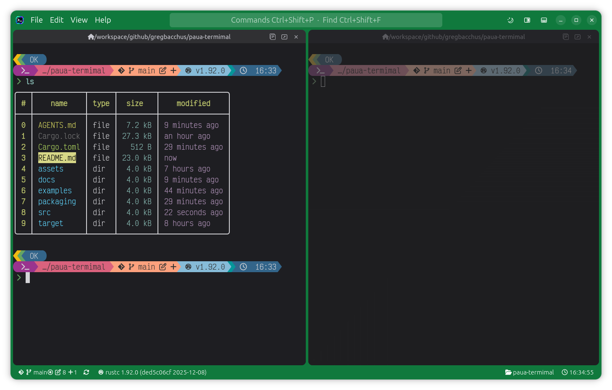

# Paua: a colourful terminal



*The screenshot shows Paua running [nushell](https://www.nushell.sh/) with a
[starship](https://starship.rs/) prompt: two panes, a custom-coloured window frame, the pane headers
and the git / Rust / clock status bar.*

*Paua* is te reo Māori for the abalone shell, famous for its iridescent colours. A pāua is a
colourful *shell*, but this one is a colourful **terminal** :)

Paua is a native Rust GTK4 + libadwaita app for GNOME with a custom-coloured window frame
(VS Code-like): app icon, menu bar and controls in the title bar, a status bar, and rounded content
panes separated by draggable dividers. No web view; GTK's CSS is only used for styling.

**Built on [Ghostty](https://ghostty.org/).** The terminal itself (escape-sequence parsing, the
screen and scrollback, selection, mouse and key encoding) is
[libghostty-vt](https://github.com/ghostty-org/ghostty), the embeddable terminal library from Ghostty;
Paua adds the GTK interface, its own GPU-friendly renderer (font ligatures, smooth scrolling), panes,
the status bar and configuration around it. Truecolor and robust terminal compatibility come from
the Ghostty engine.

**Documentation:** every configuration option is documented in [`docs/`](docs/README.md) (start with
[`docs/config/README.md`](docs/config/README.md)); a complete example is
[`examples/config.yaml`](examples/config.yaml). Contributors and coding agents: see [`AGENTS.md`](AGENTS.md).

## Get started

```bash
brew tap gregbacchus/tap
brew install paua
paua setup          # start here: the first-run wizard
paua                # run it
```

**`paua setup` is the primary first step.** It:

1. looks for the **Nerd Fonts** you have installed (Paua's icons in pane headers, the status bar
   and git status need one). If the ones it suggests are missing (Victor Mono for the terminal,
   Ubuntu for the decorations, plus an icons-only fallback) it **offers to download them for you**
   (about 9 MB), from the official Nerd Fonts release, checked against its published SHA-256 sums and
   installed with their licence files in `~/.local/share/fonts/NerdFonts`. Nothing is downloaded
   unless you say yes (or pass `--download-fonts`);
2. asks which font to use for the **terminal** (a `Propo` or `Mono` variant is best, for example
   VictorMono Nerd Font Propo) and which for the **window decorations** (pane headers and status
   bar, for example Ubuntu Nerd Font), suggesting sensible defaults: just press Enter;
3. writes a small `~/.config/paua/config.yaml` containing only those choices (it never overwrites an
   existing config without backing it up);
4. offers to add Paua to the GNOME overview and dock (the same as `paua install`).

`paua setup --yes` takes the suggestions without asking (it never downloads anything on its own),
and `paua setup --print` shows the config without writing it. `paua fonts list` / `paua fonts install
JetBrainsMono ...` download other Nerd Fonts any time. Run it again whenever you install new fonts. Everything else is optional tuning;
see the [configuration docs](docs/config/README.md).

The brew package is a prebuilt binary that uses the **system** GTK 4 and libadwaita (Ubuntu 24.04 or
newer, x86_64 or aarch64). If they are missing: `sudo apt install libgtk-4-1 libadwaita-1-0`.
Update with `brew upgrade paua`; remove with `paua uninstall` followed by `brew uninstall paua`.
To build from source instead, see below (then run `paua setup` from `target/release/paua` or
`cargo run -- setup`).

## Build from source: prerequisites (Ubuntu / GNOME)

```bash
sudo apt install build-essential pkg-config libgtk-4-dev libadwaita-1-dev
```

Needs Rust (edition 2024, tested with 1.92) and GTK >= 4.14 / libadwaita >= 1.5 (Ubuntu 24.04 or newer).

The terminal uses `libghostty-vt`, which Cargo builds from Ghostty source with **Zig 0.15.2**
(the exact version the pinned Ghostty commit requires; Ubuntu's apt `zig` is 0.14, too old). The
first build also downloads Ghostty from GitHub. Install Zig from ziglang.org (verify the checksum
published in <https://ziglang.org/download/index.json>) and put it on `PATH`:

```bash
export PATH="$HOME/.local/zig:$PATH"
```

The terminal defaults to **VictorMono Nerd Font Propo** (a ligature font); change it in the config file. Box-drawing and block characters are drawn procedurally (`src/terminal/boxdraw.rs`) so lines join exactly regardless of font.

## Run

```bash
cargo run
```

## What's here

| Path | Purpose |
|---|---|
| `src/main.rs` | Entry point: app, icons, stylesheet |
| `src/app.rs` | Window, title bar, panes, light/dark, config loading + live reload |
| `src/config.rs` | `config.yaml` / `.paua.yaml` types and parsing |
| `src/frame.rs` | Animated window-frame colour (arbitrary colour via two swapped CSS classes) |
| `src/terminal/mod.rs` | `TermView` widget: libghostty-vt emulation, PTY pump, input, smooth scrolling |
| `src/terminal/render.rs` | Reads render state; draws rows with Pango (one layout per styled run => ligatures) |
| `src/terminal/mouse.rs` | Selection (libghostty gestures), copy, mouse reporting, wheel |
| `assets/icons/.../actions/` | Split and pop-out icons (symbolic SVGs; recoloured by GTK) |
| `src/terminal/boxdraw.rs` | Procedural box-drawing / block characters |
| `src/terminal/pty.rs` | Spawns `$SHELL` on a PTY; reader thread feeds the main thread |
| `src/terminal/input.rs` | GTK key -> escape-sequence mapping (spike; to be replaced by libghostty's encoder) |
| `src/style.css` | All colours, radii, divider width, and the colour `transition` rules |
| `assets/icons/hicolor/<size>/apps/io.github.gregbacchus.Paua.png` | App icon (16 to 512 px) |

## How the look works

- The **window background is the frame colour**. The title bar and status bar are transparent, so
  they always match it exactly, including at the window's rounded corners.
- Content lives in rounded **panes** inset from the frame. The gaps between panes (the `Paned`
  separators) are transparent at the same 6px width as the side margin, so the frame colour shows
  through as dividers. Dragging a divider resizes the panes.
- **Light/dark** follows the system via `adw::StyleManager`; `main.rs` toggles `light`/`dark`
  classes on the window and the stylesheet keys off them.
- **Animated colour changes**: swap a CSS class on the window and the `transition` rules fade it
  (GTK renders on the GPU). Whole-provider swaps may not animate; class toggles do.

## Panes

The app starts with one pane. The two icons at the top right of the title bar split the focused pane
**right** or **down**. The new pane starts with one terminal in the selected tab's directory and
takes focus. Dividers drag. Panes other than the focused one are dimmed/recoloured (see `panes.inactive`).

Click **+** at the right of the pane header or press **Ctrl+Shift+T** by default to add a terminal tab there.
Tabs divide the existing header row, each with its own path, buttons, session badges, colours,
timer, and bell indicator. An underline in the window frame colour marks the selected tab. Click a
header to switch, drag to reorder, or use **Ctrl+Shift+Page Up / Page Down** to cycle. When the headers
run out of room, use a horizontal swipe or the mouse wheel over the row. Each tab keeps its own
shell and scrollback.

Header text, font, alignment, tint, and colour are configurable under `panes.header`. Tab width,
the New Tab icon, and indicator colours are configurable under `panes.tabs`.

- **Copy Path** appears beside the path when you hover over its header or focus the button with
  the keyboard. It copies that tab's real working directory.
- **Open in New Window** moves the whole pane and its running tabs to another window. It is
  available when the original window has another pane.
- **×** closes that tab. **Ctrl+Shift+W** closes the selected tab. Closing the last tab collapses its
  pane, or closes the window if it was the last pane.
- **File → Close Pane** ends all sessions in the pane, with confirmation when there is more than one tab.

Closing a window closes its panes; the app ends when the last window closes. Each window has its own
frame colour and its own focused pane, and the split buttons in a window's title bar act on that
window. Parts of the path can be rewritten with `panes.header.path_replacements` (a `from` that starts with `/`, or
`$HOME` / `~`, matches the start of the path; any other, such as `Downloads`, matches that folder
name anywhere in the path), e.g. `$HOME` -> a Nerd Font house icon (`"\uf015"`) and `Downloads` -> a download icon. If the text is too wide for the pane, the path is shortened from its middle one whole
segment at a time (`~/code/…/ui-sandbox/src`; `trim_path`, `path_ellipsis`), after the replacements
and re-fitted as the pane is resized. Button icons are configurable by name (`pop_out_icon` etc.).

## Configuration

`~/.config/paua/config.yaml` (see [`examples/config.yaml`](examples/config.yaml)); every field is
optional:

```yaml
watch: true                 # live-reload this file and the active .paua.yaml
font: { family: VictorMono Nerd Font Propo, size: 11, weight: medium, features: "-calt" }  # weight, features optional
window:                     # maximized/width/height apply at startup only
  maximized: false
  width: 1100px             # 1100, 1100px, or 80% of the monitor
  height: 80%
  color: { dark: "#4a2f80", light: "#7a56c2" }   # or a single "#rrggbb"
  inactive_dim: 0.12        # frame darkening while the window is unfocused
panes:
  padding: 0                # px inside each pane edge; or { x: 8, y: 4 } / { top, right, bottom, left }
  inactive: { dim: 0.35, saturation: 0.6, lightness: 1.0, hue_shift: 0, fade_ms: 150 }
  tabs: { min_width: 170, active_underline_height: 3 }  # active_color defaults to the window frame
  header:                   # the line above each terminal
    template: "{title|path}"   # {path} {dir} {title} {host} {user}
    align: center              # start | center | end
    font: { family: VictorMono Nerd Font Propo, size: 9.5 }
    path_replacements: [{ from: $HOME, to: "\uf015" }]
terminal: { scrollback: 10000, shell: /usr/bin/nu, scrollbar: auto, scroll_to_bottom_button: true }  # both take full maps, see examples/config.yaml
session: { detect: true, badges: true }    # ssh / sudo / container detection, see below
```

A `.paua.yaml` ([`examples/paua.yaml`](examples/paua.yaml)) in any directory overrides the window
colour while a pane whose working directory is at or below it has focus. The nearest file above the
working directory wins; it is looked up only when the directory changes (needs the shell to report
its cwd via OSC 7). Colour changes fade over 300 ms. Config errors show as a toast and the previous
settings stay in effect.

If no `.paua.yaml` sets a colour, the **VS Code project colour** is used: the nearest
`.vscode/settings.json` above the working directory is read (it may contain comments and trailing
commas) and the first of `window.vscode_color_keys` found wins: by default `peacock.color`
(the [Peacock](https://marketplace.visualstudio.com/items?itemName=johnpapa.vscode-peacock)
extension), then `titleBar.activeBackground` and `statusBar.background` from
`workbench.colorCustomizations` (what Peacock also writes, and what people set by hand; VSCodium
and Cursor use the same file). Colours may be `#rrggbb[aa]`, `rgb(...)` or a basic name. The file is
read when you enter the directory and when the pane gains focus, not watched. Our own `.paua.yaml`
colour always takes precedence; `window.vscode_colors: false` turns this off. An active
ssh/sudo session colour (see below) still wins over both.

Window **centering** is not configurable: on Wayland (GNOME) applications can't position their own
windows, and GNOME centres new windows itself.

## Terminal status

Working in the code (compiles, starts without errors, selection/mouse API checked by unit tests;
not yet visually verified): truecolor cells, bold/italic/underline/strike, wide glyphs, procedural
box-drawing, cursor, resize + reflow, IME/compose input, pixel-smooth scrolling (faster touchpad
swipes travel farther and coast after release, wheel steps ease), pane title follows the shell's cwd (OSC 7).

- **Selection:** drag to select; double-click = word, triple-click = line; Alt+drag = rectangle.
  Dragging above/below the pane autoscrolls. Selecting copies to PRIMARY (middle-click pastes);
  Ctrl+Shift+C / Ctrl+Insert copy to the clipboard; Ctrl+Shift+V pastes it; Shift+Insert pastes
  PRIMARY.
- **Mouse in programs:** when a program enables mouse tracking (vim `set mouse=a`, htop, tmux...)
  clicks, drags, hover (any-event mode) and the wheel are reported to it (SGR and legacy formats).
  Hold **Shift** to select text locally instead. On the alternate screen without mouse tracking
  (less, man) the wheel sends arrow keys. Focus in/out events are sent when requested.

Scrolling: when there is scrollback, a thin scrollbar fades in at the pane's right edge while you scroll
or when the pointer is there (`terminal.scrollbar`: `auto`, `always`, `never`); drag the thumb or click
the track to jump. While scrolled away from the bottom a small round button appears at the bottom right
(`terminal.scroll_to_bottom_button`); clicking it returns to the latest output. Both are drawn in the
pane's own text colour (or a colour you set), so they follow dimming and padding. Widths, colours,
opacities, margins and timings are all configurable (`terminal.scrollbar`, `terminal.scroll_to_bottom_button`).

## Running-command timer

When a command in a pane has been running longer than `panes.header.command_timer.after` (default
**2s**), a small chip counts up in the pane header (`12s`, `2m 05s`, `1h 02m 03s`); `position: left`
puts it before the text, `right` (default) next to the buttons. When the command ends it says
`took 12s` (or `failed (exit 1) after 12s`) for `linger` (default 4s) and fades.

Detection: if the shell emits OSC 133 semantic-prompt markers (nushell does out of the box; other
shells need shell integration) the timer uses them, so shell builtins (`sleep 10sec` in nushell) are
timed and the exit status is known. Otherwise a command counts as running while the foreground
process group on the pane's pty is not the shell itself, which covers external programs only.
Not timed: full-screen programs on the alternate screen (vim, less, htop), and the program names in
`ignore` (ssh, mosh, tmux, screen, zellij by default; remove `ssh` to time ssh sessions). Chip
colours (running / done / failed), an icon, the threshold and the linger are configurable;
`enabled: false` turns it off.

## Performance note

`.cargo/config.toml` builds the Zig terminal library (libghostty-vt) with `ReleaseFast` even for
`cargo run`. In Zig's Debug mode it re-verifies its page structures on every hyperlink operation, and
output with many OSC 8 links (nushell's `ls`/`la` link every file name) got slower with each run.

## Releasing and the Homebrew tap

Installing is covered [above](#get-started); this is how a release is made.

**CI** (`.github/workflows/ci.yml`) builds and tests every push and pull request.
**Releasing** (`.github/workflows/release.yml`): bump `version` in `Cargo.toml`, commit, then

```bash
git tag v0.1.0 && git push origin v0.1.0
```

The workflow builds both architectures, publishes a GitHub release with the tarballs and checksums,
and writes `Formula/paua.rb` (from `packaging/homebrew/paua.rb.in`) into the tap. One-time setup for
the tap: create a public repository `homebrew-tap` under your account, and add a repository secret
`HOMEBREW_TAP_TOKEN` to this repository (a fine-grained personal access token with **Contents:
read and write** on `homebrew-tap`). Without the secret the release still works and only the tap
update is skipped.

## Installing the desktop entry

```bash
cargo install --path .   # optional: puts `paua` in ~/.cargo/bin
paua install             # desktop entry + icons into ~/.local/share
paua uninstall           # remove them again
```

`paua install` writes `applications/io.github.gregbacchus.Paua.desktop` (launching the binary you ran
it from) and the icon at 16 to 512 px (built into the binary), then refreshes the icon and desktop
caches if the tools are there. After that Paua shows in the GNOME overview with its icon and the
dock groups its windows under it. Run it again if you move the binary. If there is no config file yet
it offers to run [`paua setup`](#get-started) (`--yes` accepts, `--no-config` skips the offer;
nothing is asked when it isn't running in a terminal).

## Status bar

The bar at the bottom of each window is a row of widgets, left and right. When the window is too
narrow the **lowest `priority`** widgets drop out first. Without a `status_bar.widgets` list you get
git (left), a recent-directories menu and a clock (right). Widgets describe the **selected tab in the focused pane**.

```yaml
status_bar:
  timeout: 2s                 # default kill time for exec widgets
  font: { family: "Ubuntu Nerd Font", size: 10, weight: medium, italic: false }  # all optional
  widgets:
    - { id: git,   builtin: git,   side: left,  priority: 80 }
    - { id: node,  side: left,  priority: 50, icon: "\uf898", exec: "node --version",
        when: { files: [package.json], not_files: [bun.lockb] } }
    - { id: exit,  side: right, priority: 60, text: "{?exit:exit {exit}}", color: "#ff6b6b" }
    - { id: clear, side: right, priority: 30, text: "Clear", action: clear }
    - { id: dirs,  builtin: dirs,  side: right, priority: 25 }
    - { id: clock, builtin: clock, side: right, priority: 10, format: "%H:%M" }
```

Kinds (picked by which field you set): `builtin` (`clock`, `git`, `dirs`), `exec` (a shell command;
its first output line is `{output}`), `menu` (a list of `{ label, action }`), `action` (a button) or
plain `text`. Common fields: `icon`, `tooltip`, `when` (`files` / `not_files`, looked for in the pane's
directory and its parents), `color`, `background`, `hide_empty`. Templates (`text`, `tooltip`) use
`{path} {dir} {host} {user} {title} {session} {exit} {output}`, `{a|b}` (first non-empty),
`{?x:text}` / `{!x:text}` (only if `x` is set / not set) and `{{` `}}` for literal braces.
Actions: `split_right`, `split_down`, `new_tab`, `close_tab`, `previous_tab`, `next_tab`,
`find`, `palette`, `clear`, `close_pane`, `pop_out`,
`copy_path`, `new_window`, `cycle_scheme`, `reload_config`, `open_config`, `type:<text>` (typed into
the pane, then Enter) and `exec:<command>` (runs in the background, the result is a toast).

**Nothing in the bar can hang the UI.** Commands run on worker threads, one at a time per widget,
in the pane's directory, and are killed (with everything they started) after `timeout`. A failed,
slow or empty `exec` widget just hides. Results are cached per directory (`cache`, default 30s);
`refresh: prompt` re-runs after every command (shells with OSC 133, e.g. nushell) and `interval`
re-runs on a timer while the window is focused. `exec` widgets run whatever you put in your own
config; per-directory `.paua.yaml` files can't add widgets, on purpose (a cloned repo must not be
able to run commands).

**Git.** Shells out to `git` (hidden if git is missing or the directory isn't a repository) with
`--no-optional-locks`, refreshed on directory change, after each command, and every
`git.interval`. It shows the branch, `*` when dirty, and icons with counts for conflicted, staged,
modified, deleted, renamed, untracked and stashed; ahead / behind use their own icons, and `diverged` replaces both when the branch is both. Click the branch for a searchable branch list
(**Enter** switches to the first match, or creates a branch with the name you typed) and Fetch /
Pull / Push buttons; the sync button next to it pulls (fast-forward only) then pushes, like VS Code.
Failures (a dirty tree blocking a switch, a diverged branch) show git's message as a toast. Icons,
format, counts, timeouts and the sync button are under `status_bar.git`.

## Colour themes

Terminal themes (text, background, cursor, selection and the 16 ANSI colours) can be set separately
for **light and dark**: `terminal: { theme: { dark: "Tokyo Night", light: "Tokyo Night Day" } }`.
Built in: `paua` (default), `nord`, `dracula`, `solarized`, `gruvbox`, `one`, `catppuccin`,
`tokyo-night`. **`paua themes install` downloads ~900 community themes** (the iTerm2-Color-Schemes
collection, the same one Ghostty uses), `paua themes list` shows them and `paua themes preview NAME`
shows one in your terminal. Ghostty-format theme files, and an existing Ghostty installation's
themes, work as they are. Details: [themes docs](docs/config/themes.md).

## Clickable links

Hold **Ctrl** and hover a URL: it is underlined and the pointer becomes a hand; **Ctrl+click** opens
it in your default application. Plain URLs in the output (also when they wrap over several lines)
and explicit OSC 8 hyperlinks (such as the file names in nushell's `ls`) both work. Only `http`,
`https`, `ftp`, `ftps`, `file` and `mailto` links are opened by default. In programs that use the
mouse (vim, htop) hold **Ctrl+Shift** instead. Options (modifier key, schemes, underline colour)
are under `terminal.urls` in the [terminal docs](docs/config/terminal.md#terminalurls).

## Shell integration (directory tracking)

The pane header, the window colour from `.paua.yaml` / `.vscode/settings.json`, `{path}` in the status
bar and the git widget all follow the shell's **working directory**. Paua learns it in two ways:

- **From the shell**, with the `OSC 7` escape sequence that nushell, fish and some zsh / bash setups
  send on every prompt. This is the only way to learn the directory on another machine (ssh).
- **From the system**, if the shell never sends `OSC 7` (plain bash and zsh, for example on Arch or
  Omarchy): Paua reads the shell's current directory from `/proc` a few times a second. Nothing to
  configure; it switches to `OSC 7` automatically as soon as the shell sends one.

To also get the directory (and host) right over ssh, make the shell report it. For bash, in `~/.bashrc`:

```bash
__paua_osc7() { printf '\e]7;file://%s%s\a' "$HOSTNAME" "$PWD"; }
PROMPT_COMMAND="__paua_osc7${PROMPT_COMMAND:+;$PROMPT_COMMAND}"
```

For zsh, in `~/.zshrc`: `precmd() { print -Pn "\e]7;file://%m%d\a" }`. fish and nushell do it already.

## Other desktops

Paua is GTK 4 + libadwaita, so it runs on any Linux desktop or window manager (it has been used on
Hyprland / Omarchy), not just GNOME, using its own title bar. It needs GTK >= 4.14 and libadwaita >=
1.5. The light / dark scheme comes from the desktop's setting (`org.freedesktop.appearance` via the
settings portal); if yours doesn't provide one, View -> Cycle Colour Scheme switches it by hand.

## Menus and shortcuts

The title-bar menus: **File** (New Window Ctrl+Shift+N, New Tab Ctrl+Shift+T, Close Tab Ctrl+Shift+W,
previous / next tab, split right / down, open the pane in a new window, Close Pane,
open / reload the config, Quit Ctrl+Q), **Edit** (Copy Ctrl+Shift+C,
Paste Ctrl+Shift+V, copy the working directory, Clear Terminal, Find Ctrl+Shift+F, Command Palette
Ctrl+Shift+P), **View** (cycle the colour scheme) and **Help** (Keyboard Shortcuts and About).

Press **F1** or choose **Help → Keyboard Shortcuts** to see the keys currently in effect. Set
`shortcuts` in `config.yaml` to assign a key, replace the defaults, or clear a binding. Changes apply live. See the
[shortcut reference](docs/config/shortcuts.md) for action IDs and defaults.

```yaml
shortcuts:
  keyboard_shortcuts: F1
  split_right: Ctrl+Shift+E
  new_tab: [Ctrl+Shift+T, Alt+T]
  close_tab: []
```

## Bell flash

When a program rings the terminal bell (BEL, e.g. `echo -e '\a'`), the pane header flashes and fades
out. Configure it under `panes.header.bell`: `enabled`, `duration` (fade time, default `500ms`) and
`color` (`#rrggbbaa` or `{ dark, light }`; default a soft white / black).

## Search box (find in output)

The box in the title bar searches the **selected tab in the focused pane** (scrollback and screen). Press
**Ctrl+Shift+F** or click the box; a `/` chip shows you are in find mode. Matches are highlighted in
the pane (the current one more strongly) and the box shows `3/42`. **Enter** / **Down** = next,
**Shift+Enter** / **Up** = previous (wrapping), **Esc** closes it, clears the highlights and returns
focus to the terminal. Toggles: `Aa` match case, `.*` regular expression. By default the search is
smart-case. Typing updates the results as you go, and results stay current while output arrives. If
you select another tab or focus another pane while the box is open, the find moves there. Reopening restores the
last query. A match that wraps across a soft-wrapped line break is not found. Colours and defaults
are under `search:` in the config. The same box is also the command palette (see below).

## Command palette

The title-bar box has three modes, shown by a chip at its left: idle, **find** (`/`) and **command**
(`>`). **Ctrl+Shift+P** or a click on the box opens the palette; **Ctrl+Shift+F** opens find. Type a
leading `>` or `/` to switch modes (what you typed carries over). In the palette, results are
filtered as you type with a fuzzy match (`spr` finds *Split right*; matched letters are emphasised),
**Up/Down** (or Tab/Shift+Tab, PageUp/PageDown) move the selection, **Enter** or a click runs it,
**Esc** closes. While you've typed something, the first row is **Find "…" in output**, which switches
to find with your text. What it offers:

- **Commands:** find in output, new/close/previous/next tab, split right/down, open pane in new window, close pane, copy working
  directory, new window, cycle colour scheme, reload config, open config file;
- **your own commands** (`palette.commands`: a title and text to type into the focused pane);
- **Go to** any terminal tab, including tabs in other panes and windows;
- **cd** to recently visited directories (needs the shell to report its directory via OSC 7);
- **ssh** to the hosts named in `~/.ssh/config` (wildcard hosts are skipped).

`palette.directories`, `palette.ssh_hosts`, `palette.recent_dirs` and `palette.max_results` tune it.
Typed commands go to the focused pane exactly as if you had typed them, so they only make sense at a
shell prompt.

## Session detection (ssh, sudo, ...)

Each pane's foreground process (and its ancestors/children up to the shell) is inspected through
`/proc` (`session.poll_ms`) to recognise: **ssh** (`ssh user@host`), **sudo/su/doas/pkexec**, a
**root** shell, **containers** (docker/podman/kubectl exec, distrobox/toolbox, chroot/nsenter, or
the app itself running in a container), **tmux/screen/zellij**, and **remote** hosts (mosh/telnet,
or any shell whose directory reports (OSC 7) name a different machine). What is shown:

- a **badge** per session in the pane header (`ssh me@box`, `sudo postgres`, `docker web`, `root`),
- the `{session}` placeholder for the header text template,
- a **tint on the whole pane header** (subtle built-in colours; `session.<kind>.header_background` /
  `header_color`) for the pane's most important session (root > sudo > ssh > container > remote),
- optionally the **window frame colour** (`session.<kind>.window_color`, off by default); it wins
  over a directory's `.paua.yaml` colour.

Badge text, icon and colours are configurable per kind, and each kind can be disabled. Limits: it
sees what runs locally on the pty, so once you are inside a remote shell only the `ssh` process and
(if the remote shell reports its directory) the host name are visible, not what happens inside.

Not done yet: hyperlinks, cursor blink, kitty keyboard encoder, kitty graphics, redraw only dirty
rows (currently rebuilds every frame), double-line box-drawing characters, right-click menu.
Bash/zsh on Ubuntu only emit OSC 7 inside VTE terminals; nushell emits it natively. A later step is
injecting our own shell integration.

## GTK glyph clipping workaround

[GTK #7400](https://gitlab.gnome.org/GNOME/gtk/-/work_items/7400) tracks clipped text on GTK's GPU
renderers. Cairo's FreeType backend can report a glyph's ink bounds without accounting for hinting
at the size it is drawn. GTK uses those bounds to size its glyph cache, which can drop the top
stroke of a bracket. We reproduced this with VictorMono Nerd Font Propo 11 at 100% on OpenGL and
Vulkan. Paua draws runs containing `()[]{}/\` into Cairo textures at the window's display scale.

[Cairo !686](https://gitlab.freedesktop.org/cairo/cairo/-/merge_requests/686) is the pending fix for
[Cairo #987](https://gitlab.freedesktop.org/cairo/cairo/-/work_items/987). The draft restored the
missing stroke in Paua with stock GTK and the fallback disabled. Once it ships, verify it in the
system Cairo packages Paua supports before removing `needs_cairo`, the texture cache, and the
Cairo drawing branch in [`src/terminal/render.rs`](src/terminal/render.rs). Keep the fallback for
supported systems that still ship an affected Cairo version.

To verify removal, temporarily route all runs through `Snapshot::append_layout`. With VictorMono
Nerd Font Propo installed, render the sample at `PAUA_SCALE=1` (the original reproduction), `1.5`,
and `2`, with `GSK_RENDERER=gl` and `GSK_RENDERER=vulkan`. Also check brackets during live typing
and scrolling, which exercise partial redraws.

```bash
mkdir -p /tmp/paua-render
PAUA_PNG_DIR=/tmp/paua-render PAUA_SCALE=1 GSK_RENDERER=gl cargo test render_sample -- --ignored
```

## Title bar buttons

- Moon button: cycle colour scheme System / Light / Dark (for testing).

## Notes

- The icon is found via `CARGO_MANIFEST_DIR`, which is fine for development. For packaging, install
  the SVG to `share/icons/hicolor/scalable/apps/` and add a `.desktop` file whose name matches the
  app id (`io.github.gregbacchus.Paua`), so GNOME also shows it in the dock and overview.
